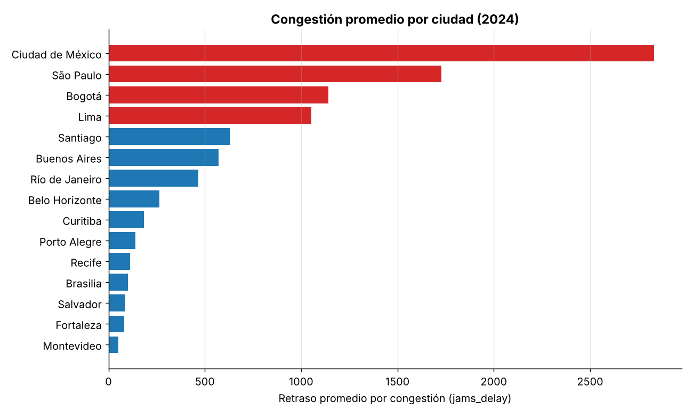
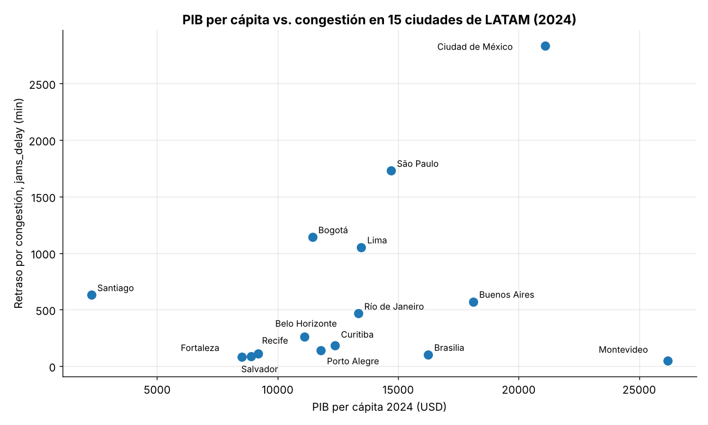

# 🚦 Movilidad urbana y productividad económica en LATAM

Análisis de la relación entre la congestión vehicular y la productividad económica (PIB per cápita) en 15 ciudades de Latinoamérica, para identificar cuáles podrían ser prioritarias para invertir en infraestructura de transporte.


---

## 🎯 Objetivo

Responder una pregunta de negocio: **¿las ciudades con mayor PIB per cápita también tienen más congestión, o no existe una relación clara?**

Para eso, el proyecto:

- Limpia y prepara los datasets de movilidad y economía.
- Analiza los patrones de congestión en ciudades de LATAM.
- Explora la relación entre los indicadores de movilidad y de productividad económica.
- Genera un dataset limpio y reproducible para análisis posteriores.

---

## 📂 Estructura del repositorio

```
├── README.md
├── Mobility_economy_project.ipynb   # Limpieza, unión de datos, análisis y conclusiones
└── images/                          # Gráficos usados en este README
```

---

## 🗃️ Datos

| Dataset | Contenido |
|---------|-----------|
| **TomTom Traffic** | Más de 1 millón de registros de tráfico por ciudad: índice de tráfico, retraso por congestión (`jams_delay`), longitud y número de atascos, y tiempos de viaje |
| **OECD City Economy** | PIB per cápita, desempleo, población y contaminación (PM2.5) por ciudad y año |

**Cobertura:** año 2024 · 15 ciudades · 7 países (Argentina, Brasil, Chile, Colombia, México, Perú y Uruguay).

---

## 🔍 Metodología

1. **Exploración:** revisión de estructura, tipos de datos y valores faltantes.
2. **Limpieza:**
   - Nombres de columnas en `snake_case`.
   - Fechas convertidas a `datetime`.
   - Columnas numéricas guardadas como texto (separadores de miles, comas decimales y `%`) convertidas a `float`.
   - Población convertida a unidades absolutas.
3. **Filtrado y agregación:** registros de 2024 y promedios anuales de tráfico por ciudad.
4. **Integración:** unión `inner` de tráfico y economía por ciudad y año, para comparar solo las ciudades presentes en ambos datasets.
5. **Visualización:** boxplots, histogramas y gráficos comparativos para revisar distribuciones, outliers y la relación entre variables.

---

## 📊 Resultados clave

### Ciudad de México es la ciudad más congestionada



| Ciudad | Retraso por congestión (min) | PIB per cápita (USD) |
|--------|-----------------------------:|---------------------:|
| Ciudad de México | 2.833 | 21.111 |
| São Paulo | 1.729 | 14.703 |
| Bogotá | 1.142 | 11.442 |
| Lima | 1.052 | 13.472 |
| Santiago | 630 | 2.277 |

- Ciudad de México es un valor atípico: su retraso por congestión es más de 4 veces el promedio (630 min).
- 8 de las 15 ciudades tienen un retraso por congestión de entre 100 y 800 min.

### No hay una relación clara entre PIB y congestión



- Hay ciudades con PIB alto y poca congestión, como Montevideo y Brasilia, y otras con PIB alto y mucha congestión, como Ciudad de México.
- Ciudades de ingreso medio, como Bogotá y Lima, también tienen congestión alta.
- 8 de las 15 ciudades tienen un PIB per cápita de entre 10.000 y 17.000 USD, pero con niveles de congestión muy distintos.
- Una correlación de Pearson calculada para este README confirma la observación visual: es débil y no significativa (r = 0,28; p = 0,31).

Esto indica que la congestión depende de varios factores además de la productividad económica, como el tamaño de la ciudad, la infraestructura o el transporte público.

---

## 💡 Recomendaciones

1. **Santiago de Chile aparece como candidata prioritaria** para invertir en infraestructura de transporte: combina el PIB per cápita más bajo del dataset con una congestión alta. Antes de decidir conviene validar su dato de PIB (2.277 USD), que es atípicamente bajo.
2. **Analizar por separado las ciudades atípicas**, como Ciudad de México.
3. **Ampliar el análisis a varios años** e incluir otras variables, como población o transporte público, para explicar mejor la congestión.

---

## ▶️ Cómo reproducirlo

```bash
pip install pandas numpy matplotlib seaborn jupyter
jupyter notebook Mobility_economy_project.ipynb
```

> Los datasets se trabajaron en la plataforma del curso (ruta `/datasets/`). Para ejecutar el notebook en otro entorno, descarga los datos de TomTom Traffic Index y OECD y ajusta las rutas de carga.

---

## 👩‍💻 Autora

**Natalia Viloria** · Data Analyst
📧 natalia.viloria2@gmail.com
